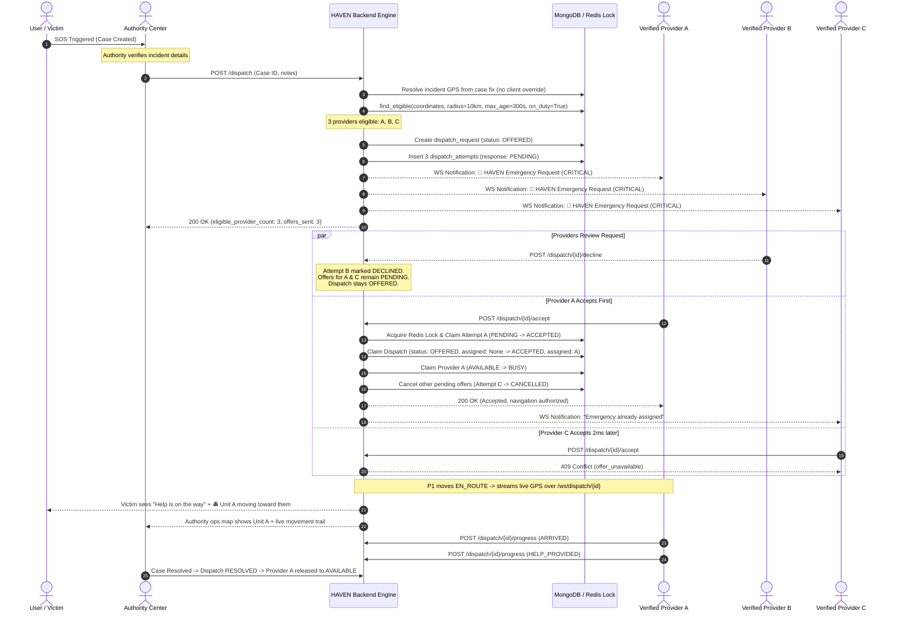

# HAVEN Rapid Response Network — Broadcast Emergency Provider Model Report

**Scope:** Transformation of HAVEN's existing Rapid Response Network from the legacy sequential nearest-responder offer model into a high-concurrency, Uber-like **"Broadcast Emergency Request to All Eligible Nearby Verified Providers"** model.

**Guiding Principles:**
- Emergency response required immediate simultaneous notification rather than sequential timeouts.
- Human-approved authority dispatch is preserved — HAVEN never autonomously dispatches units without authority confirmation.
- Only verified, registered, on-duty emergency response providers (e.g. police units, authorized NGO responders, women-safety response units) receive requests.
- First valid server-side acceptance atomically claims the dispatch; all other broadcast offers are immediately cancelled.
- Strict anti-hallucination and privacy-by-design standards: no fabricated ETAs, straight-line distance labelling, and strict audience projections.

---

## 1. Architecture Differences: Old Sequential vs. New Broadcast Model

| Dimension | Legacy Sequential Model | New Broadcast Emergency Model |
| :--- | :--- | :--- |
| **Offer Mechanism** | Nearest provider evaluated $\to$ Offer sent $\to$ Wait up to 45s $\to$ Timeout $\to$ Next provider $\to$ Wait $\dots$ | Authority approves $\to$ Backend finds **ALL** eligible nearby providers $\to$ Offers broadcast **simultaneously** |
| **Response Latency** | Worst case: $N \times 45\text{s}$ before finding an available provider. | Best case: First available provider accepts immediately (seconds). |
| **Dispatch State** | `SEARCHING` $\to$ single `OFFERED` $\to$ re-offer on decline/timeout. | `SEARCHING` $\to$ `OFFERED` (multi-attempt) $\to$ `ACCEPTED` on first claim. |
| **Attempt Records** | One active `dispatch_attempt` at any given time; matched via single `current_attempt_id`. | Concurrent `dispatch_attempt` records created for all eligible providers; indexed by `(dispatch_id, responder_id)`. |
| **Acceptance Logic** | Single-candidate claim matching `current_attempt_id`. | First valid atomic acceptance wins; remaining pending offers atomically bulk-cancelled via `_cancel_other_offers()`. |
| **Decline Behavior** | Declining triggers `_offer_next` to fetch the next unit in sequence. | Declining marks individual attempt `DECLINED`; dispatch stays `OFFERED` until all decline or time out (then `FAILED`). |
| **Expirations** | Sweeper times out single `current_attempt_id` and iterates. | Sweeper evaluates each attempt's `expires_at`; dispatch only fails when all broadcast offers expire. |
| **Authority View** | Showed only one offered responder. | Full broadcast breakdown: eligible count, offers sent, accepted, declined, waiting. |
| **Movement Trail** | Static marker only. | Client-side in-memory movement trail (max 40 real GPS frames, no DB persistence, cleared on terminal state). |

---

## 2. Complete Dispatch Lifecycle



---

## 3. Race Condition Handling & Atomic Concurrency

To ensure that **only one provider can win** when multiple providers tap ACCEPT simultaneously:

1. **Redis Fast-Lock (Optional Optimization):**
   - High-throughput deduplication lock `lock:dispatch:{dispatch_id}` acquires for 10 seconds.
2. **Step 1 — Conditional Attempt Claim:**
   ```python
   _attempts().find_one_and_update(
       {"dispatch_id": dispatch_id, "responder_id": responder_id, "response": PENDING},
       {"$set": {"response": A_ACCEPTED, "responded_at": _now()}}
   )
   ```
   - Matches only the individual provider's `PENDING` offer. If another process already cancelled or marked it, this immediately returns `None`.
3. **Step 2 — Atomic Dispatch Claim (First-Writer-Wins Gate):**
   ```python
   _dispatches().find_one_and_update(
       {"dispatch_id": dispatch_id, "status": OFFERED, "assigned_responder_id": None},
       {"$set": {"status": ACCEPTED, "assigned_responder_id": responder_id, ...}}
   )
   ```
   - The condition `"assigned_responder_id": None` is the definitive barrier. Only the first atomic update succeeds. All subsequent attempts fail and void their attempt (`A_CANCELLED`).
4. **Step 3 — Atomic Provider Booking:**
   - Calls `responder_service.try_claim_for_dispatch(responder_id, dispatch_id)`, atomically flipping provider `status: AVAILABLE -> BUSY`.
   - If the provider became busy on another case in the interim, Step 2 rolls back: the dispatch reverts to `OFFERED` (or `FAILED` if no pending offers remain).
5. **Step 4 — Atomic Bulk Cancellation:**
   - Once Step 3 succeeds, `_cancel_other_offers(dispatch_id, winning_attempt_id)` marks all other `PENDING` attempts as `CANCELLED`.
6. **Losing Racer Outcome:**
   - Returns HTTP `409 offer_unavailable`. Never produces duplicate primary responders.
7. **Double-Click Idempotency:**
   - If the winning provider double-clicks `ACCEPT`, `accept_offer` checks if `assigned_responder_id == responder_id` and `status in (ACCEPTED, EN_ROUTE, ARRIVED, HELP_PROVIDED)`, returning the existing dispatch document without error or duplicate events.

---

## 4. Privacy & Anti-Surveillance Controls

1. **Role-Based Safe Projections (`public_view`):**
   - **Victim Audience:**
     - Receives `{dispatch_id, status, help_on_the_way: bool, responder_label: string}`.
     - **NEVER** receives coordinates of nearby unassigned providers.
     - **NEVER** receives officer names, phone numbers, badge numbers, internal responder IDs, or database primary keys.
     - Once accepted, only the accepted provider's live location is streamed.
   - **Provider Audience:**
     - Receives incident location coordinates and requested capabilities necessary to navigate and respond.
     - **NEVER** receives victim name, phone number, account ID, internal case notes, or full case history.
   - **Authority Audience:**
     - Receives operational counts: `eligible_provider_count`, `offers_sent`, breakdown of `ACCEPTED`/`DECLINED`/`PENDING`/`TIMEOUT`.
     - Unit locations are displayed strictly as operational markers (`Verified Response Unit HR-204`) with straight-line distance.
2. **Duty-Gated Geolocation Tracking:**
   - Providers in `OFFLINE` / `OFF_DUTY` state are never tracked.
   - Background GPS is restricted to browser/device foreground sessions.
   - WebSockets are strictly gated to non-terminal assigned states (`ACCEPTED`, `EN_ROUTE`, `ARRIVED`). As soon as an incident terminates (`HELP_PROVIDED`, `RESOLVED`, `CANCELLED`), broadcasting is immediately disabled and cached fixes are purged.

---

## 5. Location Streaming Architecture & Movement Trail

1. **Connection Channel:**
   - Uses the existing authenticated WebSocket: `/ws/dispatch/{dispatch_id}?token={token}`.
   - Token authentication verifies identity and role.
2. **Freshness Classification:**
   - 🟢 **LIVE:** Fix received $<30\text{s}$ ago.
   - 🟠 **STALE:** Fix received $\ge 30\text{s}$ ago ("Responder location temporarily unavailable").
   - 🔴 **DISCONNECTED:** WebSocket connection interrupted or closed.
3. **Client-Side Movement Trail:**
   - **Real GPS Frames Only:** No interpolation, dead reckoning, or fabricated points.
   - **Memory-Only:** Maximum 40 recent coordinate points stored in React component state.
   - **Zero DB Persistence:** GPS breadcrumbs are never written to MongoDB collections.
   - **Lifecycle-Bound:** Automatically wiped on component unmount, active dispatch change, or incident resolution.
4. **Interactive Controls:**
   - `[ Follow responder ]`: Centers and tracks moving provider.
   - `[ Fit incident + responder ]`: Frames both incident 📍 and provider 🚔.

---

## 6. Test Coverage Summary (93 Total Passing Tests)

The test suite consists of **93 total automated tests across 3 suites**, with zero failures:

### Suite 1: `test_rapid_response_network.py` (50 Passed)
- **Original Architecture & FSM (24 tests):**
  - `test_fsm_valid_transitions`, `test_fsm_rejects_illegal_jumps`
  - `test_eligibility_hard_predicates`, `test_eligibility_distance_then_order_and_radius`, `test_eligibility_capability_and_jurisdiction_and_exclude`
  - `test_create_dispatch_rejects_bad_location`, `test_create_dispatch_fails_when_no_eligible_responder`, `test_create_dispatch_duplicate_guard`, `test_create_dispatch_offers_and_audits_human_approved`
  - `test_accept_binds_responder_and_victim_sees_help_on_the_way`, `test_accept_is_idempotent_on_replay`, `test_non_offered_responder_cannot_accept`
  - `test_decline_reoffers_to_next_unit`, `test_timeout_escalates_then_fails_when_exhausted`
  - `test_cancel_frees_bound_responder`, `test_resolve_for_case_frees_responder_and_is_idempotent`
  - `test_mark_progress_happy_path_and_idempotent_replay`, `test_mark_progress_rejects_forbidden_bad_state_and_illegal_jump`
  - `test_public_view_authority_is_operational_without_victim_pii`, `test_public_view_victim_hides_pii_and_coords_and_never_fabricates_eta`, `test_public_view_responder_has_incident_but_no_victim_identity`
  - `test_responder_cannot_be_claimed_for_two_dispatches_concurrently`, `test_try_claim_is_atomic_under_many_threads`, `test_audit_trail_logs_identifiers_only_across_a_full_flow`
- **Broadcast Model Requirements (26 tests):**
  1. `test_broadcast_dispatch_creates_offers_for_all_eligible_providers`
  2. `test_first_acceptance_wins_atomically`
  3. `test_concurrent_accept_second_provider_gets_409`
  4. `test_concurrent_accept_third_provider_gets_409`
  5. `test_other_offers_cancelled_after_first_accept`
  6. `test_cancelled_offer_cannot_be_accepted_later`
  7. `test_declined_offer_leaves_other_offers_pending`
  8. `test_all_declined_marks_dispatch_failed`
  9. `test_timeout_on_single_provider_leaves_others_pending`
  10. `test_timeout_on_all_providers_marks_dispatch_failed`
  11. `test_provider_double_click_accept_is_idempotent`
  12. `test_provider_becomes_busy_elsewhere_before_accept_fails_safely`
  13. `test_off_duty_provider_not_eligible_for_broadcast`
  14. `test_out_of_radius_provider_not_eligible`
  15. `test_wrong_jurisdiction_provider_not_eligible`
  16. `test_stale_location_provider_not_eligible`
  17. `test_unverified_provider_not_eligible`
  18. `test_inactive_provider_not_eligible`
  19. `test_authority_sees_broadcast_offer_breakdown`
  20. `test_authority_map_shows_eligible_providers_before_accept`
  21. `test_authority_map_shows_only_assigned_after_accept`
  22. `test_victim_sees_only_assigned_provider_after_accept`
  23. `test_victim_never_sees_unassigned_nearby_providers`
  24. `test_progress_state_machine_en_route_arrived_help_provided`
  25. `test_cancel_dispatch_cancels_all_broadcast_offers`
  26. `test_movement_trail_real_gps_only_max_40_in_memory`

### Suite 2: `test_rrn_authority_views.py` (25 Passed)
- Authority authorization, safe projections, metrics aggregation, network roster queries, straight-line distance calculations, and freshness tests.

### Suite 3: `test_incident_location.py` (18 Passed)
- Server-side GPS resolution from cases, numeric coordinate extraction, legacy string coordinate parsing, and validation boundaries.

---

## 7. Comparative Audience Views

| Component | Authority View | Verified Provider View | Victim / User View |
| :--- | :--- | :--- | :--- |
| **Header / Badge** | Rapid Response Center | HAVEN Responder Console | HAVEN Safety Dashboard |
| **Status Details** | Broadcast breakdown (eligible, sent, accepted, declined, waiting) | Duty status toggle: `[ GO ON DUTY ]`, `[ GO OFF DUTY ]` | Clean notification: "Help is on the way" |
| **Incoming Offer Card** | Read-only summary of broadcast status | 🚨 HAVEN EMERGENCY (CRITICAL), countdown timer (MM:SS), `[ ACCEPT ]`, `[ DECLINE ]` | N/A (Victim does not see raw negotiation) |
| **Unit Identity** | "Verified Response Unit HR-204" | Own badge and unit profile | "Verified Response Unit HR-204" |
| **Live Map** | Incident 📍 + eligible units (○) before accept; moving unit 🚔 + movement trail after accept | Incident 📍 + own live GPS fix 🚔 + movement trail | Incident 📍 + moving unit 🚔 only (never nearby units) |
| **Location Freshness** | 🟢 Live ($<30\text{s}$) / 🟠 Stale ($\ge 30\text{s}$) / 🔴 Disconnected | Live fix accuracy radius ($\pm X\text{ m}$) | Truthful relative update ("Updated 3s ago") |

---

## 8. Anti-Hallucination & Operational Honesty Guarantees

1. **No Estimated Time of Arrival (ETA):**
   - HAVEN **never fabricates or guesses traffic ETAs**. In every service layer and view, `eta_minutes` remains strictly `None` or `Route estimate unavailable`.
2. **Straight-Line Distance Only:**
   - All distance calculations derive from direct spherical Haversine equations and are explicitly labelled `straight-line`.
3. **No Phantom GPS Breadcrumbs:**
   - Movement trail strictly accepts verified coordinates from hardware `watchPosition`. No spline interpolation or synthetic smoothing.
4. **Authoritative Incident Positioning:**
   - Incident coordinates are resolved server-side from stored case GPS data. The frontend can neither alter coordinates nor inject arbitrary response points.
5. **Fail-Closed Verification Gates:**
   - Unverified accounts or units with stale locations ($>300\text{s}$) are filtered out before broadcast offer creation.
